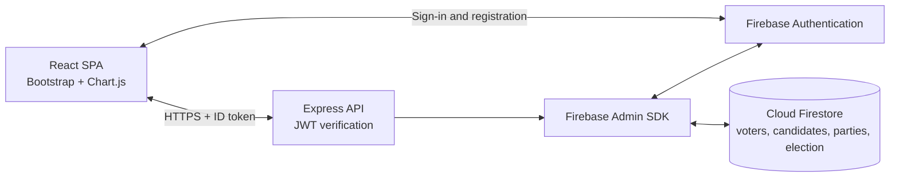

<div align="center">

# GEVS

**General Election Voting System**

A full-stack online voting platform for a fictional election commission: voter registration, one vote per voter, live results and an election commission dashboard.


[Features](#features) · [Architecture](#architecture) · [API](#api) · [Setup](#setup) · [Security](#security)

</div>

> **Coursework and demo project.** GEVS was built for a fictional election in Shangri-La. It is not affiliated with a real election authority and is not designed for production use.

## Overview

GEVS allows eligible voters to register, authenticate, cast one vote in their constituency and view results. Election commission staff get a separate dashboard for running the election, resetting data and announcing a winner. The backend also exposes a small open-data API for constituency and national results.

The project is split into a React single-page application and an Express API backed by Firebase Authentication and Cloud Firestore.

## Features

### Voter experience

- Register with a Unique Voter Code (UVC), entered manually or scanned as a QR code.
- Sign in with email and password.
- View the candidates standing in your constituency.
- Cast one vote and see a confirmation.
- Review your account details and voting status.
- View constituency and national results.

### Election commission

- Protected election commission dashboard.
- Start and end the election.
- Monitor live vote counts.
- Reset candidate votes and party seats.
- Determine and publish the overall winner.
- View charts of constituency and national results.

### Open data

- Public constituency result endpoint.
- Public national result endpoint with party seats and election status.

## Architecture



The React app obtains a Firebase ID token and sends it to the Express API as a Bearer token. The API verifies the token with the Firebase Admin SDK before reading or writing protected data.

## Tech stack

| Layer | Technology |
|---|---|
| Frontend | React 18, React Router 6, Bootstrap 5, Chart.js, qr-scanner, Axios |
| Backend | Node.js, Express 4, Firebase Admin SDK |
| Authentication | Firebase Authentication, email and password |
| Database | Cloud Firestore |
| Tooling | Create React App, concurrently, npm |

## API

### Public endpoints

| Method | Endpoint | Purpose |
|---|---|---|
| `GET` | `/gevs/constituency/:constituencyName` | Vote counts for one constituency |
| `GET` | `/gevs/results` | Election status, winner and party seats |

### Authenticated endpoints

All protected routes expect `Authorization: Bearer <firebase-id-token>`.

| Method | Endpoint | Purpose |
|---|---|---|
| `POST` | `/signup` | Register a voter and consume a UVC |
| `POST` | `/login` | Exchange email and password for a Firebase token |
| `POST` | `/validateUVC` | Check whether a UVC is valid and unused |
| `POST` | `/checkEmailExists` | Check whether an email is already registered |
| `GET` | `/validateToken` | Verify the current session |
| `GET` | `/getVoterInfo/:userId` | Voter profile and voting status |
| `GET` | `/getCandidates/:constituency` | Candidates in a constituency |
| `GET` | `/getCandidates` | All candidates |
| `POST` | `/castVote` | Cast a vote |
| `GET` | `/electionDetails` | Current election window and status |
| `POST` | `/startElection` | Start the election |
| `POST` | `/endElection` | End the election |
| `POST` | `/resetVotes` | Reset all votes |
| `POST` | `/resetPartySeats` | Reset party seats |
| `POST` | `/updatePartySeats` | Update a party's seat count |
| `GET` | `/determineOverallWinner` | Calculate the winner |
| `GET` | `/parties` | Party list and seat counts |

## Firestore data model

| Collection | Main fields |
|---|---|
| `voters` | `voter_id`, `full_name`, `DOB`, `constituency`, `UVC`, `hasVoted`, `votedFor` |
| `uvc_codes` | `UVC`, `used` |
| `candidates` | `name`, `constituency`, `party`, `vote_count` |
| `parties` | `name`, `seatsWon` |
| `constituencies` | Constituency records used by the results views |
| `election` | `status`, `start_time`, `end_time`, `winner` |

The backend currently reads the election document by a fixed ID in `server.js`. Create that document or update the ID to match your Firebase project.

## Setup

### Prerequisites

- Node.js 18 or newer (the original project used Node 21)
- npm
- A Firebase project with Authentication and Cloud Firestore enabled

### 1. Install dependencies

```bash
cd voting-app
npm install

cd frontend
npm install

cd ../backend
npm install
```

The root package uses `concurrently` to run both apps together.

### 2. Configure Firebase

1. Create a Firebase project and enable **Authentication > Email/Password**.
2. Create a **Cloud Firestore** database.
3. Register a Web app and copy its configuration into `voting-app/frontend/src/firebase.js`.
4. Create a service account key in **Project settings > Service accounts**.
5. Place the key in the backend folder or point the backend at it through an environment variable. Keep the key out of Git.

The backend also uses a Firebase Web API key for password sign-in. Treat that value as configuration, not as a repository secret, and replace it with your own project's key.

### 3. Seed Firestore

Create the collections listed above. At minimum you need:

- One `election` document with `status`, `start_time`, `end_time` and `winner`.
- `candidates` with a `constituency` field and a numeric `vote_count`.
- `parties` with `seatsWon`.
- `uvc_codes` with `UVC` and `used: false`.
- `constituencies` records for the result views.

The original coursework dataset is not included in the repository. Do not reuse publicly posted demo codes in a real deployment.

### 4. Run

From `voting-app`:

```bash
npm start
```

This starts the React app on <http://localhost:3000> and the API on <http://localhost:5000>.

To run them separately:

```bash
cd frontend
npm start
```

```bash
cd backend
node server.js
```

## Project layout

```text
voting-app/
├─ frontend/                 React application
│  ├─ src/
│  │  ├─ LandingPage.js
│  │  ├─ VoterDashboard.js
│  │  ├─ ElectionCommissionDashboard.js
│  │  ├─ ConstituencyResults.js
│  │  ├─ ElectionResults.js
│  │  ├─ AuthContext.js
│  │  └─ firebase.js
│  └─ public/
├─ backend/                  Express API
│  ├─ server.js              Routes, Firebase Admin and vote logic
│  └─ package.json
└─ package.json              Runs both apps with concurrently
```

## Security

This repository is a coursework prototype. Before adapting it for anything public:

- Revoke and rotate any Firebase service-account key that has ever been committed to Git.
- Load credentials from environment variables or a secret manager, never from source control.
- Replace the demo Firebase project with your own and tighten Firestore security rules.
- Add rate limiting, audit logging and stronger election controls.
- Do not publish administrator passwords, UVC lists or other live credentials in the README.
- Review the authentication and authorisation paths before trusting the result.

## License

No open-source license is included. The project is shared as a portfolio and coursework example. Contact the author before reusing it.
